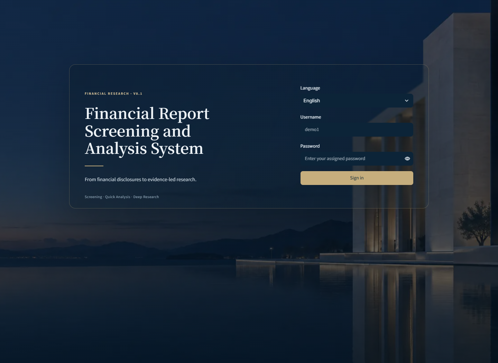
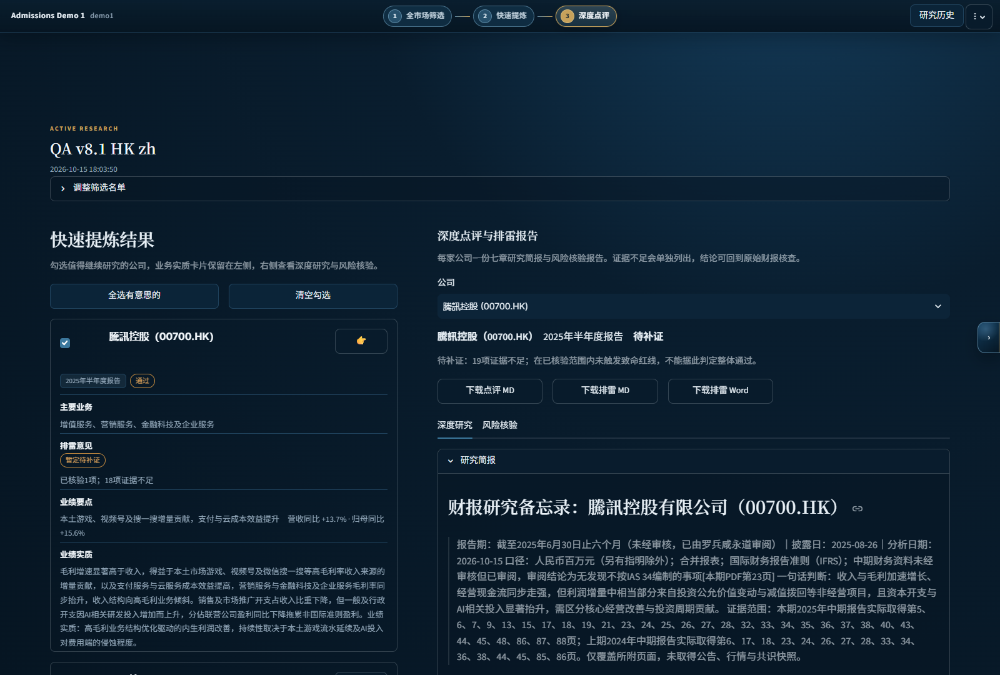

# Financial Report Analyzer

A bilingual research workbench for Mainland China A-share and Hong Kong listed companies: from official filings to evidence-linked summaries, research briefs and independent risk review.

[中文说明](README.zh-CN.md) · [Architecture](docs/ARCHITECTURE.md) · [Project and AI-assisted development](docs/PROJECT_NOTES.md) · [Research method](docs/RESEARCH_METHOD.md) · [Tests](tests/)

**Personal project by Jason · Public source snapshot based on v8.1 · Python / Streamlit**

## Interface preview

Historical v8.1 QA captures. They show the existing interface, not a new live test; this public release replaces the original account configuration.





## Start here

No installation or model key is needed to read these historical outputs:

| Issuer and source period | English brief | Chinese brief |
| --- | --- | --- |
| Kweichow Moutai · 2025 interim | [Read](samples/a-600519-2025h1-en.md) | [阅读](samples/a-600519-2025h1-zh.md) |
| Tencent · 2025 interim | [Read](samples/hk-00700-hk-2025h1-en.md) | [阅读](samples/hk-00700-hk-2025h1-zh.md) |

The [sample manifest](samples/manifest.json) records source filings, preparation dates and the scope of the historical checks. These are pre-generated examples, not live runs. Their metadata explicitly distinguishes automated checks from completed manual financial review.

## Why I built it

Reviewing company reports involves repetitive retrieval, extraction and summarization, followed by much less mechanical questions about earnings quality and risk. I wanted to turn that workflow into a practical tool while learning how programming and language models can support financial research.

The application combines model-assisted narrative analysis with explicit Python checks and visible evidence gaps. It is a research prototype: the goal is to make a first-pass analysis more inspectable, while leaving important financial judgments open to review.

## What it does

- **Find official filings:** CNINFO and HKEX discovery, issuer matching, reporting-period metadata and full-report versus summary distinctions.
- **Select evidence:** PDF extraction with physical page references, topic-based retrieval and preservation of primary-statement pages and continuations.
- **Produce analysis:** quick operating summaries, seven-section research memos and a separate risk-review workflow.
- **Check boundaries:** missing evidence, reference-page availability, explicit addition/subtraction equations and selected accounting-scope issues, including Hong Kong reported versus adjusted figures.
- **Recover from failures:** bounded targeted repair, saved per-company checkpoints and background-job recovery.
- **Work bilingually:** English and Chinese UI; separate original and translated outputs, with protected numbers and references.
- **Export work:** Markdown research briefs and spreadsheet/document artifacts, with saved research history.

## Engineering to inspect

| Question | Implementation |
| --- | --- |
| How are long reports reduced without dropping primary statements? | [Evidence selection](deep_research.py) |
| How are incomplete analysis and scope errors handled? | [Generation and validation](engine.py), [statement scope](statement_scope.py), [HK checks](hk_quality.py) |
| How is an evidence gap kept distinct from a clean risk finding? | [Risk engine](screening_engine.py), [versioned analysis contracts](screening/) |
| How does work resume after an interrupted stage? | [Job launcher](background_jobs.py), [worker](job_worker.py), [store](research_store.py) |
| How are numbers and references protected during translation? | [Translation and export checks](i18n.py) |
| How can the behavior be checked? | [Regression tests](tests/), [validation notes](docs/VALIDATION.md) |

## Run locally

Python 3.12 is the tested interpreter for this public snapshot.

```bash
git clone https://github.com/Jason-Wu-7744/Financial-Report-Analyzer.git
cd Financial-Report-Analyzer
python -m venv .venv
# Windows: .venv\Scripts\activate
# macOS/Linux: source .venv/bin/activate
python -m pip install -r requirements.txt
```

Copy `.env.example` to `.env`:

```powershell
# Windows PowerShell
Copy-Item .env.example .env
```

```bash
# macOS/Linux
cp .env.example .env
```

In `.env`, choose your own login password in `RESEARCH_ACCOUNTS_JSON`. Set your model key and an available model/endpoint, or use the local Settings panel with `CLOUD_SHARE=0`. The supplied model name reflects the source snapshot; change it if your provider does not offer it. No deployed account or real model key is included.

```bash
python -m streamlit run app.py --server.address 127.0.0.1 --server.port 8581
```

Open `http://127.0.0.1:8581/?lang=en` and sign in with your configured account. Use `?lang=zh` for Chinese. Start a research workspace, choose a market, enter a company identifier or use the example workbook, retrieve/upload the relevant filing, and run the desired stage. New model-generated analysis and dynamic translation require a working API connection and may incur provider charges. The linked sample files remain readable without credentials.

## Run tests

```bash
python -m pip install -r requirements-dev.txt
python -m pytest tests -q
```

The suite uses test-only accounts and mocked model responses. It covers evidence and accounting-scope regressions, malformed outputs, translation preservation, risk evidence states, background recovery and Streamlit AppTest workflows. Test passes do not establish financial accuracy, live-provider reliability or a performance benchmark.

## Development and limitations

Developed using AI-assisted coding tools, including Codex and Cursor. [Project notes](docs/PROJECT_NOTES.md) describe the motivation, the development approach and the public-release changes. The repository makes the implementation and tests available for inspection rather than claiming unaided authorship of every line.

Extraction can miss scanned content, layouts or notes. A valid citation page does not prove an inference. A correct displayed equation does not establish correct accounting classification. Outputs need review against original filings and do not constitute investment advice.

The local account gate is not production identity management. Public hosting requires additional authentication, job isolation and operational controls. This source snapshot excludes deployment secrets, private thesis materials, server scripts, caches, full downloaded filing corpora and broker PDFs. No open-source license has been selected for this release; public visibility alone is not a license grant.
