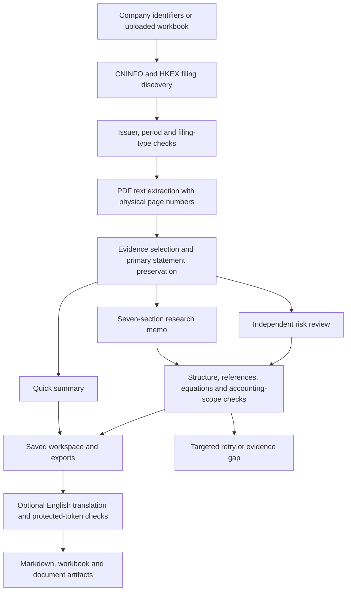

# Architecture and engineering decisions

[简体中文](ARCHITECTURE.zh-CN.md) · [Project home](../README.md)

## Workflow

## Module map

| Module | Responsibility |
| --- | --- |
| `app.py`, `styles.py`, `company_list_ui.py`, `card_presentation.py` | Streamlit workspace, company selection, status and report presentation |
| `cninfo.py`, `hkex.py` | Official filing discovery, issuer identifiers and report metadata |
| `engine.py` | PDF extraction, fast summaries, research generation, repair and exports |
| `deep_research.py`, `statement_scope.py`, `hk_quality.py` | Evidence budgets, primary statements, scope checks and Hong Kong accounting distinctions |
| `screening_engine.py`, `screening/` | Risk-review rules, output contracts and explicit evidence states |
| `background_jobs.py`, `job_worker.py`, `research_store.py` | Background processes, checkpoints and per-user/per-language persisted work |
| `i18n.py`, `ui_i18n.py`, `locales/` | Bilingual UI, protected figures/references and separate translated exports |
| `auth.py` | Environment-configured local access gate without bundled deployment accounts |
| `tests/` | Deterministic regressions and Streamlit AppTest workflows |

## Why the system combines rules and a language model

A model can organize narrative disclosures, but it should not silently determine accounting scope or treat missing disclosure as a clean bill of health. Python handles evidence selection, state transitions, explicit equation checks and export validation. Versioned Markdown instructions define the model's analysis and reporting contract. Neither layer proves the economic interpretation is correct; users must review important claims against the original filing.

The application retains the four evidence states: verified without a trigger, verified with a trigger, insufficient evidence, and not applicable. This avoids conflating an unsuccessful check with a negative finding.

## Why keep checkpoints

Large filings, network requests, generation and translation can fail independently. Saved per-company/per-language checkpoints let users resume a failed stage without regenerating all successful work. Model keys used by background jobs are passed through process environment, rather than written into saved request JSON.

## Translation design

English output is derived from the source-language artifact, with protected numbers and references. Original and translated artifacts remain separate. A failed language or token check must remain visible and retryable. A successful check establishes consistency with the protected tokens, not correctness of the underlying financial assertion.

## Current tradeoffs

- The application is a research prototype with a large orchestration module. Further separation of retrieval, validation and presentation would improve maintainability.
- Persistence uses local files and background processes. Multiple application instances need stronger job coordination and storage isolation.
- The account gate is intended for local review. A public hosted service needs proper identity management, rate limiting, TLS, secret management and operational monitoring.
- Filing layout changes, scanned PDFs, omitted notes and model errors can break extraction or inference.
- Download and model latency vary. This release makes no benchmark or audited financial-accuracy claim.
